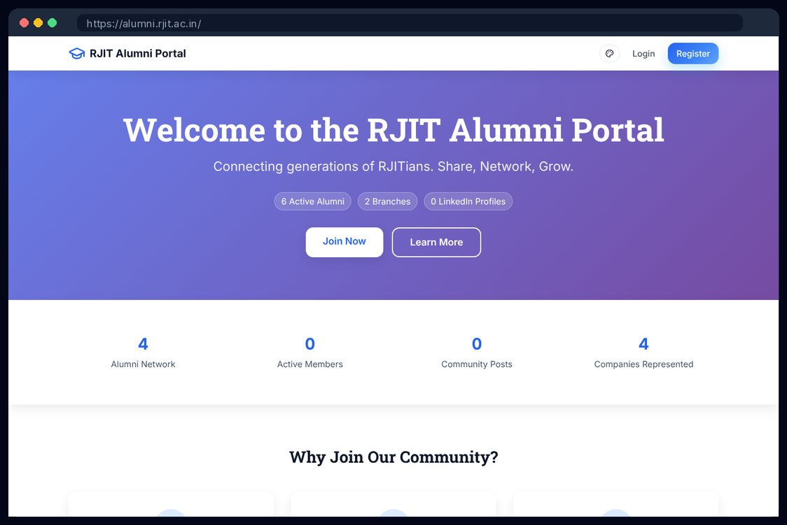
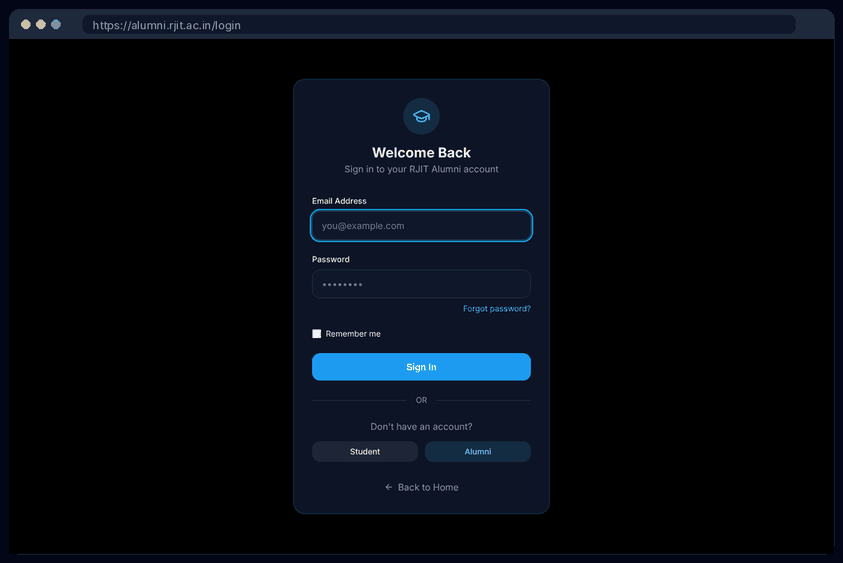
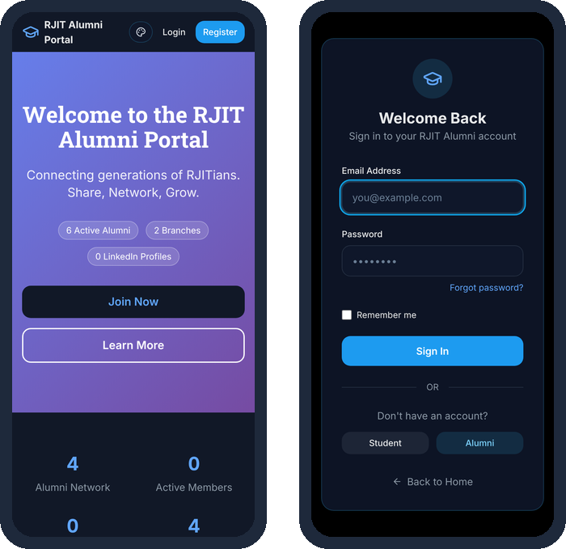
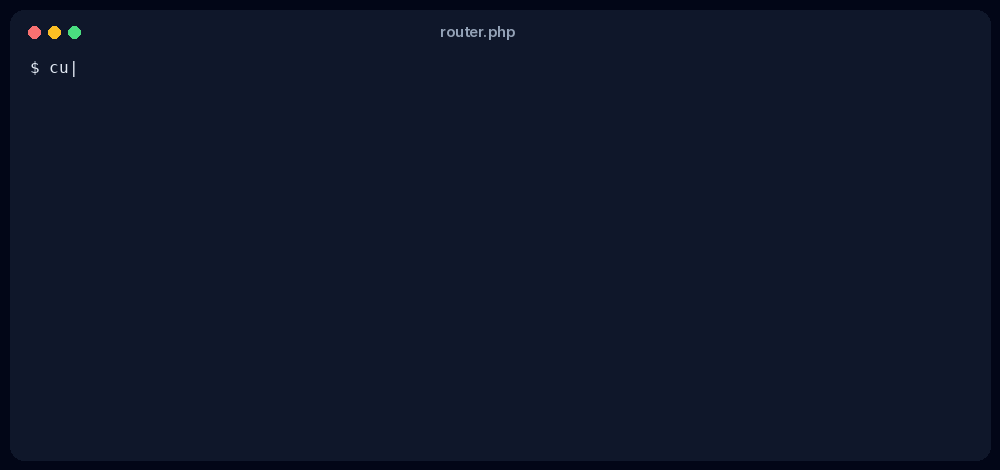
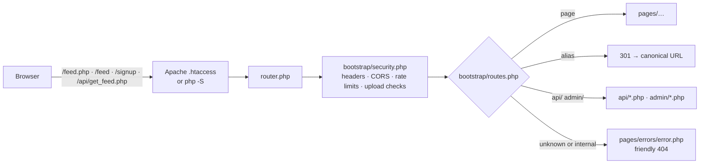

<div align="center">


<h3>The campus hub where RJIT students, alumni and faculty meet, mentor, hire and grow together.</h3>

[](https://github.com/shiroonigami23-ui/Alumni-Portal/actions/workflows/ci.yml)
[](LICENSE)


[](SECURITY.md)
[](CONTRIBUTING.md)

[**Live demo**](http://alumni-portal-alb-616743364.us-east-1.elb.amazonaws.com/) ·
[Features](#-features) ·
[Screenshots](#-screenshots) ·
[Quick start](#-quick-start) ·
[Routing](#-routing--urls) ·
[Security](#-security) ·
[Deploy](#-deployment) ·
[Contributing](CONTRIBUTING.md)

</div>

---

<div align="center">

<br><sub>A quick tour — landing page, sign-in, registration, help centre, the friendly 404 and legal pages.</sub>
</div>

## 📚 Table of contents

- [What is this?](#-what-is-this)
- [Features](#-features)
- [Screenshots](#-screenshots)
- [Tech stack](#-tech-stack)
- [Project structure](#-project-structure)
- [Quick start](#-quick-start)
  - [Docker (fastest)](#option-a--docker-fastest)
  - [XAMPP + PostgreSQL](#option-b--xampp--postgresql-windows)
  - [XAMPP + MySQL](#option-c--xampp--mysql-windows)
  - [PHP built-in server](#option-d--php-built-in-server-any-os)
- [Configuration](#-configuration)
- [Routing & URLs](#-routing--urls)
- [Security](#-security)
- [Testing](#-testing)
- [Deployment](#-deployment)
- [API overview](#-api-overview)
- [Roadmap](#-roadmap)
- [Contributing, conduct & license](#-contributing-conduct--license)

---

## 🎓 What is this?

**RJIT Alumni Portal** is a full-stack community platform for **Rustamji Institute of Technology (RJIT), Gwalior**. It brings students, alumni, faculty and admins into one place to:

- 🤝 **Connect** — a searchable alumni directory with batch, branch, company and city filters
- 🧭 **Mentor** — structured mentor ↔ mentee matching with private mentor-group chats and live audio/video spaces
- 💼 **Hire** — a job board where alumni post roles and students apply with their résumé
- 📣 **Share** — a social feed with posts, polls, GIFs, attachments, reposts and reactions
- 📅 **Meet** — events with RSVPs, attendee lists and live streams
- 🛡️ **Stay safe** — reporting, moderation queues, shadow-bans, device bans and an admin console

It runs on plain **PHP 8 + PostgreSQL/MySQL**, works on **XAMPP** for college servers, ships as a **Docker** image, and deploys to **AWS (ECS + RDS + S3)** with Terraform.

---

## ✨ Features

<table>
<tr>
<td width="50%" valign="top">

### 👥 Community & profiles
- Role-aware accounts: **student, alumni, faculty, admin, moderator**
- Rich profiles: avatar, cover, bio, company, role, skills, socials
- Profile privacy controls and blocking
- Activity timeline with posts **and** reposts
- Automatic **student → alumni** promotion at graduation (cron)
- Verified-alumni document flow with admin approval
- GDPR-style **data export** (streamed privately to the owner)

### 📰 Feed
- Posts with images, files, **GIF search** (Wikimedia Commons), polls
- Reactions, threaded comments & replies, reposts, shares
- Pinned posts, scheduled posts, drafts, editing
- Infinite scroll, upload progress, view counts
- Report content → moderation queue

</td>
<td width="50%" valign="top">

### 🧭 Mentorship
- Mentor applications (alumni) with faculty/admin approval
- One active mentor per person, enforced server-side
- Auto-created **mentor groups** with chat, ban/kick/unban
- Shared live **audio/video mentor spaces** (Jitsi)

### 💬 Messaging
- Direct messages and mentor-group conversations
- Edit / delete messages and unread counts
- 1:1 **audio/video calls** with in-app call notifications

### 💼 Careers & events
- Job board with applications and résumé upload
- Events with RSVP, attendee lists, approval workflow
- Live-stream sessions and success stories

### 🛠️ Admin & moderation
- Admin dashboard with live stats
- User management: ban, suspend, shadow-ban, device ban, mute DMs
- Reports, announcements approval, alumni token generation
- Bulk user actions and activity logs

</td>
</tr>
</table>

**Everywhere:** installable **PWA** with offline page and push notifications · **dark / light / ocean** themes · mobile bottom-nav · IST-consistent timestamps · in-app dialogs instead of browser pop-ups · accessible focus rings, skip-link and reduced-motion support.

---

## 🖼️ Screenshots

<div align="center">

| Landing (dark) | Landing (light) |
|:---:|:---:|
|  |  |
| **Sign in** | **Register** |
|  |  |
| **Help centre** | **Friendly 404 with quick links** |
|  |  |


<br><sub>Theme switching — every page follows the active theme (dark is the default).</sub>
<br><br>

<br><sub>Mobile-first: bottom navigation, compact layouts and an installable app.</sub>

</div>

---

## 🧰 Tech stack

| Layer | Technology |
|---|---|
| Backend | PHP 8.2+, PDO, Composer (AWS SDK) |
| Database | PostgreSQL 15 (primary) or MySQL 8 / MariaDB (XAMPP) via `config/DbCompat.php` |
| Frontend | Server-rendered PHP pages, Tailwind CSS, Lucide icons, vanilla JS |
| Realtime-ish | Polling APIs, Web Push, Jitsi rooms for calls |
| Storage | DB-backed asset & content store; S3 in production |
| Infra | Docker, Apache (`mod_rewrite`), Terraform → AWS VPC, ALB, ECS Fargate, RDS, S3, CloudWatch, SES |
| CI | GitHub Actions — PHP lint, route/security smoke test, image build & ECS deploy |

---

## 🗂️ Project structure

The root holds only entry points. Pages, APIs and infrastructure each live in their own folder.

```text
Alumni-Portal/
├── index.php               # Landing page
├── router.php              # ★ Front controller — every page & API request goes through here
├── .htaccess               # Apache rules: send requests to the router, hide internals
├── sw.js · manifest.webmanifest · offline.html   # PWA (must stay at the root for scope)
│
├── pages/                  # All user-facing pages (served at their old URLs, e.g. /feed.php)
│   ├── dashboard.php  feed.php  profile.php  settings.php  messages.php
│   ├── discovery.php  mentorship.php  jobs.php  events.php  moderation.php
│   ├── help.php  live.php
│   ├── auth/               # login, register, forgot-password, reset
│   ├── legal/              # terms, policy (privacy), conduct
│   └── errors/error.php    # Friendly 404 / 429 / 415 … page
│
├── admin/                  # Admin console pages
├── api/                    # JSON endpoints (files starting with _ are internal helpers)
├── bootstrap/
│   ├── routes.php          # ★ Route table: pages, aliases/redirects, executable dirs
│   ├── security.php        # ★ Security layer (headers, CSP, CORS, rate limits, upload checks)
│   └── static_policy.php   # Which static files may be served
├── config/                 # Database + AWS config
├── middleware/             # Auth (bearer sessions), CSRF/security helpers
├── models/  helpers/       # Domain models and services (email, S3, logging, streams…)
├── includes/               # Shared header, sidebar, footer, auth-check.js
├── assets/                 # CSS, JS, icons, images, README media
├── cron/                   # Scheduled jobs (publish posts, archive, promote students)
├── storage/                # Runtime uploads (never committed, never executable)
├── fallback_content/       # Demo content shown when the DB is empty/offline
├── deployment/             # SQL schema + migrations, Apache vhost, deploy scripts
├── terraform/              # AWS infrastructure as code
├── scripts/                # Import/maintenance utilities
├── tests/                  # Smoke tests (CI) + local PowerShell feature matrix
└── docs/                   # Deployment guides, technical write-up, dev notes
    └── deployment/         # AWS_DEPLOYMENT, QUICKSTART_AWS, POSTGRES_SETUP, DEPLOYMENT
```

---

## 🚀 Quick start

### Option A — Docker (fastest)

```bash
git clone https://github.com/shiroonigami23-ui/Alumni-Portal.git
cd Alumni-Portal
cp .env.example .env
docker compose up --build
# then load the schema once:
docker compose exec -T db psql -U postgres -d alumni_portal < deployment/db.sql
```

Open **http://localhost/** — health check at **http://localhost/healthz**.

### Option B — XAMPP + PostgreSQL (Windows)

```bat
scripts\start_local_xampp.bat
```

This starts XAMPP PostgreSQL on `127.0.0.1:5433` and Apache. Open `http://127.0.0.1:8088/` (or `http://localhost/<folder-name>/`).

> Make sure Apache has `mod_rewrite` enabled and `AllowOverride All` for the project folder (XAMPP's default for `htdocs`). The router works both at the domain root and inside a sub-folder.

### Option C — XAMPP + MySQL (Windows)

1. **Start** Apache and MySQL in the XAMPP Control Panel.
2. **Create the database**
   ```bat
   C:\xampp\mysql\bin\mysql.exe -u root -e "CREATE DATABASE IF NOT EXISTS alumni_portal CHARACTER SET utf8mb4 COLLATE utf8mb4_unicode_ci;"
   ```
   (add `-p` if your MySQL root user has a password)
3. **Import the schema + MySQL migration**
   ```bat
   C:\xampp\mysql\bin\mysql.exe -u root alumni_portal < deployment\db.sql
   C:\xampp\mysql\bin\mysql.exe -u root alumni_portal < deployment\sql\2026_04_12_moderator_post_workflow_mysql.sql
   ```
4. **Tell PHP which database to use.** The app reads settings from the environment (`getenv`). Add inside your `<VirtualHost>` in `C:\xampp\apache\conf\extra\httpd-vhosts.conf`:
   ```apache
   SetEnv DB_DRIVER mysql
   SetEnv DB_HOST 127.0.0.1
   SetEnv DB_PORT 3306
   SetEnv DB_NAME alumni_portal
   SetEnv DB_USER root
   SetEnv DB_PASSWORD your_mysql_password
   ```
   Restart Apache.
5. **Verify the connection**
   ```bat
   C:\xampp\php\php.exe -r "require 'config/Database.php'; var_dump((new Database())->getConnection() !== null);"
   ```
   `bool(true)` means you're connected.
6. **Open** `http://localhost/alumni_portal/` (or whatever your folder is called).

### Option D — PHP built-in server (any OS)

```bash
php -S localhost:8088 router.php
```

`router.php` doubles as the built-in server's router script, applying exactly the same routes and security rules as Apache.

---

## ⚙️ Configuration

Copy `.env.example` → `.env` (Docker) or set the same keys as Apache `SetEnv` / ECS task variables.

| Variable | Purpose | Default |
|---|---|---|
| `DB_DRIVER` | `pgsql` or `mysql` | `pgsql` |
| `DB_HOST`, `DB_PORT`, `DB_NAME`, `DB_USER`, `DB_PASSWORD` | Database connection | — |
| `APP_ENV`, `APP_DEBUG`, `APP_URL` | Environment; `APP_DEBUG=true` shows raw errors | `production`, `false` |
| `AWS_REGION`, `AWS_BUCKET`, `AWS_SES_*`, `AWS_CLOUDWATCH_*` | S3 uploads, SES email, CloudWatch logs | — |
| `ALLOWED_ORIGINS` | Extra origins allowed to call the API from browsers | *(same-origin only)* |
| `TRUSTED_PROXIES` | CIDRs allowed to set `X-Forwarded-*` | loopback + private ranges |
| `RATE_LIMIT_API_PER_MIN` | API requests per IP per minute | `300` |
| `RATE_LIMIT_LOGIN` | Login attempts per IP per 10 min | `20` |
| `LOGIN_MAX_FAILURES`, `LOGIN_LOCK_SECONDS` | Per-account lockout after wrong passwords | `8`, `900` |
| `MAX_REQUEST_MB` | Largest accepted request body | `25` |
| `CSP_CONNECT_EXTRA` | Extra `connect-src` hosts (e.g. a streaming server) | — |

---

## 🧭 Routing & URLs

<div align="center">

</div>

Every `.php` request and every URL that isn't a real static file goes through **`router.php`**, driven by the table in **`bootstrap/routes.php`**:



**Nothing that worked before breaks.** Browser URLs never change, so every relative link, asset path and API call in the pages keeps resolving:

| You visit | You get |
|---|---|
| `/feed.php` *(old URL)* | `pages/feed.php` — 200 |
| `/feed` *(clean URL)* | the same page — 200 |
| `/edit-profile.php` | 301 → `/settings.php#profile` |
| `/signup`, `/join`, `/sign-up` | 301 → `/register.php` |
| `/privacy`, `/directory`, `/careers`, `/inbox`, `/admin` … | 301 → the right page |
| `/pages/feed.php` *(internal path)* | 301 → `/feed.php` |
| `/feed/` *(trailing slash)* | 301 → `/feed` |
| `/config/Database.php`, `/api/_feed_schema.php`, `/storage/verification/…` | 404 — never served |
| anything unknown | friendly 404 with quick links |

**Add a page:** drop the file in `pages/` and add one line to `'pages'` in `bootstrap/routes.php`.
**Rename a page:** change its target and add the old slug to `'redirects'` — old links keep working forever.

---

## 🔐 Security

Security is centralised in `bootstrap/security.php`, which runs **before every page and API script**, so new endpoints are protected automatically. It aims to be strict without getting in the way: every block returns a clear, human message.

| Layer | What it does |
|---|---|
| **Front controller** | Only routed pages, `api/*.php` and `admin/*.php` can execute. Internal helpers (`api/_*.php`), `config/`, `models/`, `helpers/`, `middleware/`, `cron/`, `scripts/`, `bootstrap/` are unreachable. Path traversal is rejected. |
| **Headers** | Content-Security-Policy (no plugins, no foreign framing, locked `base-uri`/`form-action`), `X-Frame-Options`, `nosniff`, strict Referrer-Policy, Permissions-Policy (camera/mic only for Jitsi), COOP, HSTS on HTTPS. APIs get a sandboxed `default-src 'none'` CSP and `no-store`. |
| **CORS** | The legacy `Access-Control-Allow-Origin: *` on ~100 endpoints is rewritten to **same-origin + `ALLOWED_ORIGINS`** only; hostile pre-flights are refused. |
| **Brute-force protection** | Sliding-window rate limits per IP for all APIs, stricter limits for login, registration and password-reset, plus a **per-account lockout** after repeated wrong passwords ("try again in 12 minutes, or use Forgot password"). |
| **Real client IP** | `X-Forwarded-For` is trusted **only** from configured proxies (e.g. the ALB), so bans and rate limits can't be bypassed by spoofing a header. |
| **Uploads** | Every file is checked platform-wide: dangerous and double extensions (`shell.php.jpg`) refused, real MIME sniffed with `finfo` and matched to the extension, images must decode, and files with embedded `<?php` / `<script>` (polyglots) are blocked. |
| **Storage** | `storage/` can never execute PHP, serves media/documents only, and private areas (verification documents, exports, logs, caches) are never web-visible. Uploaded files are served with a sandbox CSP. |
| **Data exports** | Personal data archives are streamed to the authenticated owner and deleted immediately — never left at a guessable public URL. |
| **Sessions** | `HttpOnly`, `SameSite=Lax`, `Secure` on HTTPS, strict mode, longer IDs, custom cookie name. Bearer tokens are 256-bit random and expire after 7 days. CSRF tokens are checked for cookie-based requests. |
| **Error hygiene** | In production, API responses that would leak SQL errors, stack traces or server paths are replaced with a friendly message; the original is logged server-side. |
| **Server** | `expose_php` off, `ServerTokens Prod`, `TRACE` disabled, no directory listings, non-standard HTTP methods rejected, request-size cap. |

Found a vulnerability? Please follow **[SECURITY.md](SECURITY.md)** — don't open a public issue.

---

## 🧪 Testing

```bash
# Route + security smoke test (no database needed) — also runs in CI
bash tests/smoke/routes.sh

# Lint every PHP file
find . -name '*.php' -not -path './vendor/*' -print0 | xargs -0 -n1 php -l
```

Full end-to-end feature matrix against a local database (Windows / PowerShell):

```powershell
$env:PGPASSWORD=""
powershell -ExecutionPolicy Bypass -File .\tests\local\verify_feature_matrix.ps1
```

It covers auth & profile, feed/posts/comments/reactions, messaging, events & RSVP, jobs & applications, mentorship, resources & success stories, notifications, uploads, search and the live-stream lifecycle.

---

## ☁️ Deployment

### AWS (Terraform + ECS + RDS + S3)

1. **Tools:** AWS CLI, Terraform, Docker, Git, `psql`.
2. **Credentials:** `aws configure` (region e.g. `us-east-1`).
3. **Variables:** `cd terraform && cp terraform.tfvars.example terraform.tfvars` — set `aws_region`, `environment`, `db_password`, sizing.
4. **Infrastructure:** `terraform init && terraform plan && terraform apply`, then `terraform output`.
5. **Image:** `./deployment/deploy-aws.sh` (Git Bash on Windows).
6. **Database:** `./deployment/migrate-to-rds.sh`, then run the SQL migrations in `deployment/sql/` on RDS.
7. **Runtime env:** set `DB_*`, `AWS_REGION`, `AWS_BUCKET`, `APP_ENV=production`, `APP_DEBUG=false` on the ECS task.
8. **Verify:** `curl http://<alb_dns_name>/healthz` and open `/`.

Pushing to `main` runs the **Deploy to AWS** workflow automatically (build → ECR → ECS).

Detailed guides: [Quick start on AWS](docs/deployment/QUICKSTART_AWS.md) · [Full AWS guide](docs/deployment/AWS_DEPLOYMENT.md) · [PostgreSQL setup](docs/deployment/POSTGRES_SETUP.md) · [General deployment](docs/deployment/DEPLOYMENT.md) · [Android APK build](docs/APK_BUILD.md)

> **Production checklist:** never commit `.env`; keep secrets in AWS Secrets Manager / ECS env vars; use RDS + S3; run migrations before traffic; attach an ACM certificate so the ALB serves HTTPS (HSTS and secure cookies switch on automatically).

---

## 🔌 API overview

All endpoints live in `api/` and return JSON. Authenticate with `Authorization: Bearer <token>` from `POST /api/login.php`.

| Area | Endpoints (selection) |
|---|---|
| Auth | `login`, `register_student`, `register_alumni`, `register_faculty`, `request_reset`, `reset_password`, `change_password`, `me`, `csrf_token` |
| Feed | `get_feed`, `create_post`, `edit_post`, `delete_post`, `react_to_post`, `create_comment`, `add_reply`, `toggle_repost`, `share_post`, `create_poll`, `vote_poll`, `schedule_post`, `pin_post`, `search_gifs` |
| People | `search_directory`, `search_alumni`, `get_user_profile`, `update_profile`, `upload_avatar`, `upload_cover`, `connect_user`, `block_user`, `update_privacy`, `export_data` |
| Mentorship | `mentorship?action=…` (list mentors, request, accept, groups, moderation) |
| Messages | `get_conversations`, `get_messages`, `send_message`, `edit_message`, `delete_message`, `start_call` |
| Careers & events | `get_jobs`, `post_job`, `apply_job`, `get_applicants`, `get_events`, `create_event`, `rsvp_event`, `get_event_attendees` |
| Admin | `admin_stats`, `admin_users`, `admin_user_actions`, `admin_report_action`, `moderation_queue`, `approve_user`, `generate_token` |

Clean forms like `/api/get_feed` work too.

---

## 🗺️ Roadmap

- [ ] HTTPS on the production ALB (ACM certificate)
- [ ] Self-hosted Tailwind build (drop the CDN warning, tighten CSP further)
- [ ] Server-synced post drafts across devices
- [ ] Two-factor sign-in for admins and faculty
- [ ] Alumni map by city and company, batch reunions page
- [ ] Referral board ("I can refer you at …") and give-back / donations

See the full history in **[CHANGELOG.md](CHANGELOG.md)** and the running deploy log in **[docs/DEV_NOTES.md](docs/DEV_NOTES.md)**.

---

## 🤝 Contributing, conduct & license

- **Contributing:** read [CONTRIBUTING.md](CONTRIBUTING.md) — setup, branch/commit style, how to add pages & routes, PR checklist.
- **Community standards:** [CODE_OF_CONDUCT.md](CODE_OF_CONDUCT.md). The portal's own user-facing rules are at `/conduct.php`, `/terms.php` and `/policy.php`.
- **Security:** [SECURITY.md](SECURITY.md).
- **License:** [MIT](LICENSE) © 2026 Aryan Singh Chandel. Faculty photos and RJIT imagery belong to their owners and are used for the institute's portal only.

<div align="center">
<br>
Made with ❤️ for the RJIT community · <a href="https://github.com/shiroonigami23-ui">@shiroonigami23-ui</a>
</div>
